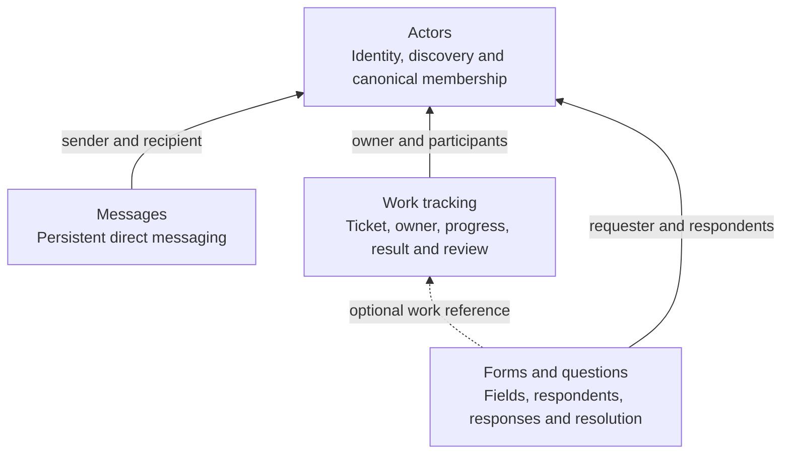
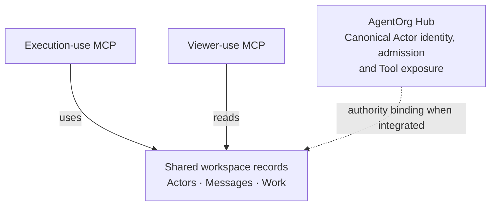

# Design and boundaries

The lasting accepted references are [Workspace first version tool list](https://chatgpt.com/space/page_120b6e009e708191ad4dabcb0a739053) and [Agent coordination build or reuse assessment](https://chatgpt.com/space/page_836285fe88908191a181d7e96783f3aa). The graphs below preserve the accepted component and exposure graphs. Exact contracts and local policies were subsequently settled by delivery management before implementation; package placement inside Hub was selected by the human.

## Component dependencies

Arrows point toward a dependency; dashed edges are optional. Forms and Work tracking are separate modules; a Form can stand alone.

## Exposure and authority

Both MCP exposures use the same Actor identity and role rules. The execution server exposes all 16 operations. The viewer server exposes eight reads and refuses writes, using the same underlying clients and authority checks. The SDK owns protocol initialization, transports, request dispatch, and shutdown. The package constructs an SDK server; the host connects it to an SDK transport and closes it.

## Module contracts

| Module        | Consumes                                         | Exposes                                            | Owns                                                                             |
| ------------- | ------------------------------------------------ | -------------------------------------------------- | -------------------------------------------------------------------------------- |
| Actors        | Injected canonical authority and admitted caller | `ActorsClient.get/list/within`                     | No persisted state; no lifecycle administration                                  |
| Messages      | Actors; Messages persistence                     | `MessagesClient.send/get/list`                     | Content, parties, conversation and order                                         |
| Work tracking | Actors; Work persistence                         | `WorkClient` and its read-only `WorkReader` subset | Tickets, requester, owner, goal, progress/status, submission, review, history    |
| Forms         | Actors; optional WorkReader; Forms persistence   | `FormsClient`                                      | Fields, respondents, latest answers and every prior response, closure/resolution |

Work does not import Messages or Forms. A Work ticket needs neither. Messages link no Work, and Forms need no work ticket or Work client; a reply is another message in the pair's conversation. A Form's optional Work reference validates existing shared Work on creation and has no lifecycle effect. Messages have no public read/handling state or dependent acknowledgement step. Work and Forms, including history, are public within the admitted organization; Messages remains private to sender/recipient. Form reads require no Work lookup. Work progress may contain stable record references as text; it has no reverse Form mutation or automatic blocker gate.

The host binds one organization's canonical authority and persistence into the composition. Shared reads authenticate the existing caller; they do not construct a privileged Actor. Work owner/requester/status and Form work/requester/respondent/status/awaiting filters intersect before pagination, using the same traversal and record schemas. Business write roles remain separate from shared visibility.

The required synchronous canonical `within(callerID, actorID, ancestorID)` relationship read supplies inclusive retained ancestry, including closed positions and descendants beyond any Team depth limit. The bound Actor client revalidates its active caller; Work/Form predicates apply the five subtree criteria before traversal limits. Workspace stores no hierarchy or new Actor field and adds no MCP Tool. The model-free fixture alone holds a manager map for its example truth. Requester scope is immutable record origin, not causal ticket lineage. Independent lane cursors and bounded from-zero refresh/reconciliation preserve the current-upsert limitations described in the contract.

The root composition factory wires distinct clients; it is not another multi-domain operation client. Consumers can construct and use any module independently through its own export. Contracts depend only on Zod. Domain modules import persistence types; native SQLite is loaded only through the persistence implementation export.

A Message's `conversationID` is derived from its pair when read and its `seq` is its module cursor, so neither is stored and there is no conversation registry. A later kind of conversation, such as a group or a Work thread, would store its own ID beside these without migrating them. Lists issue opaque positions that encode the read's filter and a cursor, so a position never continues another read; the records themselves carry no cursor, except a Message's `seq`. Each list resolves the Actor names it mentions through the directory, so a reader needs no lookup per ID.

## Persistence and state changes

SQLite has separate current-snapshot and history tables for Messages, Work and Forms. There is no Actor table. Each mutation writes the current snapshot and one module-owned history entry together inside `BEGIN IMMEDIATE`/commit, or rolls back both. History includes actor, time, action, revision, cursor and changed details. A record's `updatedAt` is the time of the history entry for its current revision. Old submissions, reviews and responses remain in history after newer ones replace their current fields; reads return history only when asked. IDs are UUIDs; the Work primary ID is named `ticketID`, and other records carry the same value as `workID`.

The database records its schema in `PRAGMA user_version`. Opening a database runs, in one transaction, every upgrade step after its version: 0 is a database written by 0.4 or earlier. Steps change current snapshots in place and never rewrite history, so an original value a step removes stays in the event that recorded it. A database newer than the package is refused and left unchanged. Version 1 removes `workID` from Message snapshots.

Each module advances a persisted cursor on every mutation. Current snapshots are traversed by cursor; histories are read with their owning record. [List semantics](contracts.md#lists) describe the positions and limits. No event replay framework, scheduler, notification dispatcher, model executor or native session controller is part of this package. Record-changing communication happens only through these clients/tools; ordinary prose has no effect.

The v1 persistence adapter loads current snapshots for scoped filtering and returns full history for a record when asked. It is intended for the initial small workspace, without bounded-history or large-corpus performance guarantees. Database files belong to the host: use trusted local paths, appropriate filesystem access, and close owned connections before deleting test data. The fixture entry point has no production credential or network admission surface.

## Repository map

`src/contracts` owns runtime schemas and exported types. Each of `src/actors`, `src/messages`, `src/work`, and `src/forms` exposes its client. `src/persistence` owns the storage boundary and SQLite implementation. `src/mcp` adapts those clients to SDK servers. `src/index.ts` composes clients. Model-free authorities and stdio use live only in `examples`; they are not exported as production identity services. Tests include a packed-package consumer installed outside this repository.
