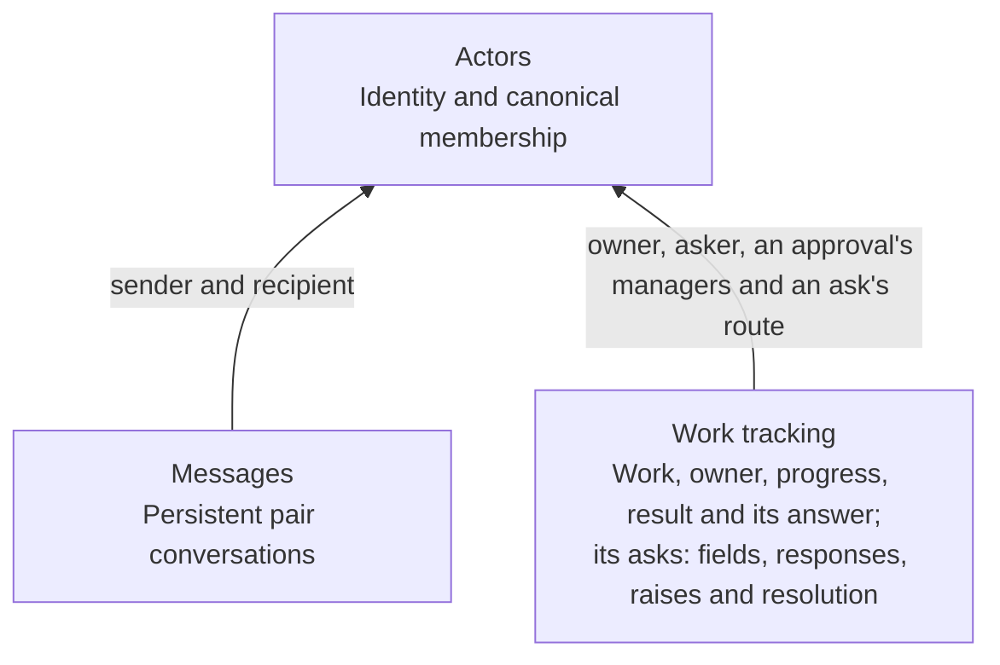
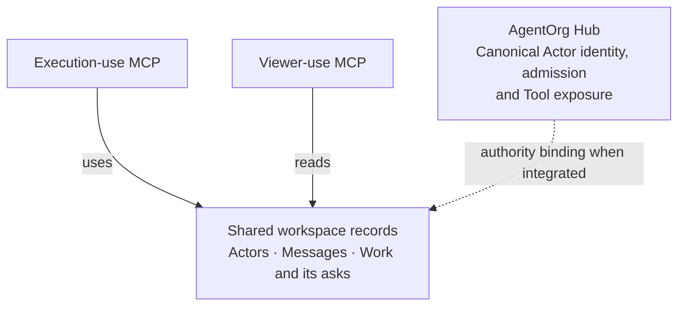

# Design and boundaries

The lasting accepted references are [Workspace first version tool list](https://chatgpt.com/space/page_120b6e009e708191ad4dabcb0a739053) and [Agent coordination build or reuse assessment](https://chatgpt.com/space/page_836285fe88908191a181d7e96783f3aa). The graphs below preserve the accepted component and exposure graphs. Exact contracts and local policies were subsequently settled by delivery management before implementation; package placement inside Hub was selected by the human.

## Component dependencies

Arrows point toward a dependency. An ask is part of the Work its asker owns, so the Work module owns asks too; Messages link no Work.

## Exposure and authority

Both MCP exposures use the same Actor identity and role rules. The execution server exposes all 9 operations. The viewer server exposes four reads and refuses writes, using the same underlying clients and authority checks. The SDK owns protocol initialization, transports, request dispatch, and shutdown. The package constructs an SDK server; the host connects it to an SDK transport and closes it.

## Module contracts

| Module        | Consumes                                         | Exposes                           | Owns                                                                                                                                                                                                           |
| ------------- | ------------------------------------------------ | --------------------------------- | -------------------------------------------------------------------------------------------------------------------------------------------------------------------------------------------------------------- |
| Actors        | Injected canonical authority and admitted caller | `ActorsClient.get/within/manager` | No persisted state; no lifecycle administration                                                                                                                                                                |
| Messages      | Actors; Messages persistence                     | `MessagesClient.send/get/list`    | Content, parties, conversation and order                                                                                                                                                                       |
| Work tracking | Actors; Work and Forms persistence               | `WorkClient`                      | Work: requester, owner, title, goal, progress, status, links, waits-on, submission, review, completion, history; and its asks: fields and options, approval, collection, responses with notes, raises, closure |

Work does not import Messages. Messages link no Work; a reply is another message in the pair's conversation. An ask is stored in its own row of the forms table, beside its Work, so asking, answering, raising and closing never move the Work's revision. Submitting, cancelling or reassigning Work cancels its open asks in the same transaction. An ask's route is derived when read, from its asker, its raises and the host's `manager` relation, and nothing stores a destination. Messages have no public read/handling state or dependent acknowledgement step. Work and its asks, with their history, and Messages are public within the admitted organization. Work progress may contain stable record references as text.

The host binds one organization's canonical authority and persistence into the composition. Shared reads authenticate the existing caller; they do not construct a privileged Actor. Work and ask filters intersect before pagination, using the same traversal and record schemas. Business write roles remain separate from shared visibility.

The required synchronous canonical `within(callerID, actorID, ancestorID)` relationship read supplies inclusive retained ancestry, including closed positions and descendants beyond any Team depth limit. The bound Actor client revalidates its active caller; Work predicates apply the subtree criteria before traversal limits, and an approval's answer requires the responder to be a strict ancestor of the asker. Workspace stores no hierarchy or new Actor field. The model-free fixture alone holds a manager map for its example truth. Requester scope is immutable record origin, not causal ticket lineage. Independent lane cursors and bounded from-zero refresh/reconciliation preserve the current-upsert limitations described in the contract.

The root composition factory wires distinct clients; it is not another multi-domain operation client. Consumers can construct and use any module independently through its own export. Contracts depend only on Zod. Domain modules import persistence types; native SQLite is loaded only through the persistence implementation export.

A Message's `conversationID` is derived from its pair when read and its `seq` is its module cursor, so neither is stored and there is no conversation registry. A later kind of conversation, such as a group or a Work thread, would store its own ID beside these without migrating them. Lists issue opaque positions that encode the read's filter and a cursor, so a position continues only its own read (a `between` read and a `counterpartyID` read of one pair are the same read); the records themselves carry no cursor, except a Message's `seq`. Each list resolves the Actor names it mentions through the Actor authority, so a reader needs no lookup per ID.

## Persistence and state changes

SQLite has separate current-snapshot and history tables for Messages, Work and asks (the `forms` table); a version 3 database also holds the `status` and `status_history` tables, which this package leaves in place, unread. There is no Actor table. Each mutation writes the current snapshot and one module-owned history entry together inside `BEGIN IMMEDIATE`/commit, or rolls back both. History includes actor, time, action, revision, cursor and changed details. A record's `updatedAt` is the time of the history entry for its current revision. Old submissions, reviews and responses remain in history after newer ones replace their current fields; reads return history only when asked. IDs are UUIDs; the Work primary ID is named `ticketID`, and other records carry the same value as `workID`.

The database records its schema in `PRAGMA user_version`. Opening a database runs, in one transaction, every upgrade step after its version: 0 is a database from before storage versions, or a new one, where the data steps find no rows. Steps change current snapshots in place and never rewrite history, so an original value a step removes stays in the event that recorded it. A database newer than the package is refused and left unchanged. A title a step derives is the first line of the source text, cut at a word boundary to 120 characters with "…"; the source text is unchanged.

- Version 1 removes `workID` from Message snapshots.
- Version 2 gives Work a `title` from its goal and empty `links`, and gives accepted Work the `completedAt` of the review that accepted it.
- Version 3 turns Forms into asks. Each ask gets a `title` from its first field's label, empty `links`, `approval: false` and `collect: true`, because a Form before version 3 stayed open until its requester closed it and keeps doing so. `respondentIDs` is removed, each option string becomes `{value}`, and each response becomes `{answers, at}`, with the time of that responder's last answer.
- Version 4 adds indexed, generated columns and rewrites no record:
  - Messages' `sender` and `recipient`;
  - Work's `owner`, `requester`, `status` and `submission` (the current submission's ID). The `status` column holds a stored `blocked` as `active`. The owner and requester indexes are on (party, status);
  - asks' `requester`, `status`, `work` and `route`, indexed on (requester, status), (work, status) and (status, route). `route` is where an ask's route starts: its last raiser, else its asker. The destination comes from the Actor tree when it is read, so it is never stored.

Each module advances a persisted cursor on every mutation. Current snapshots are traversed by cursor; histories are read with their owning record. [List semantics](contracts.md#lists) describe the positions and limits. No event replay framework, scheduler, notification dispatcher, model executor or native session controller is part of this package. Record-changing communication happens only through these clients/tools; ordinary prose has no effect.

The persistence adapter selects current snapshots through those indexed columns (`RecordTable.where`), and reads a column's distinct values (`values`) so that a subtree filter tests each Actor once. A party's index leads with the party and then status, so a party's records in some statuses are one index range, whatever statistics the planner has. Other filters apply to the decoded rows. It returns full history for a record when asked. It makes no bounded-history or large-workspace guarantee: a list decodes every row its indexed filters keep before paging, and a list with no indexed filter decodes every row of its table. An Actor's conversations read every message it sent or received. Database files belong to the host: use trusted local paths, appropriate filesystem access, and close owned connections before deleting test data. The fixture entry point has no production credential or network admission surface.

## Repository map

`src/contracts` owns runtime schemas and exported types. Each of `src/actors`, `src/messages` and `src/work` exposes its client; `src/work/asks.ts` holds an ask's rules. `src/persistence` owns the storage boundary and SQLite implementation. `src/mcp` adapts those clients to SDK servers. `src/index.ts` composes clients. Model-free authorities and stdio use live only in `examples`; they are not exported as production identity services. Tests include a packed-package consumer installed outside this repository.
