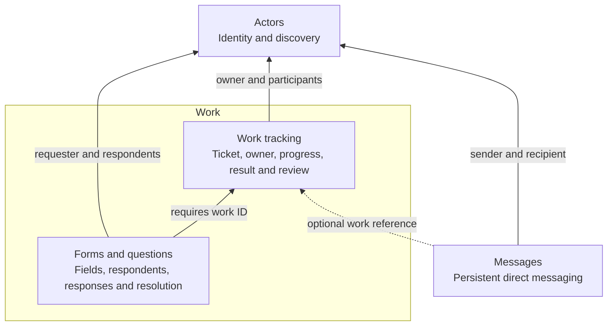
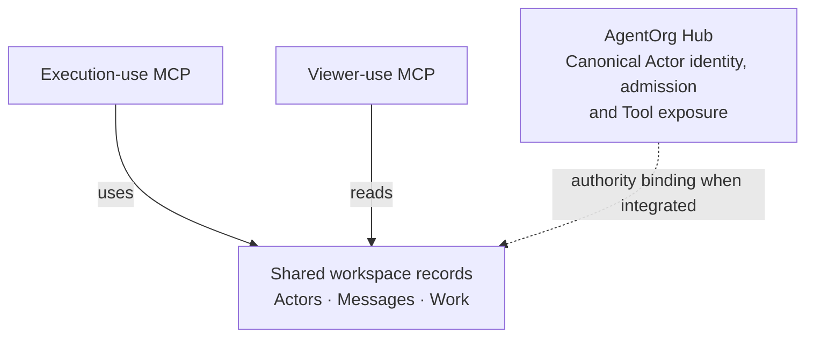

# Design and boundaries

The lasting accepted references are [Workspace first version tool list](https://chatgpt.com/space/page_120b6e009e708191ad4dabcb0a739053) and [Agent coordination build or reuse assessment](https://chatgpt.com/space/page_836285fe88908191a181d7e96783f3aa). The graphs below preserve the accepted component and exposure graphs. Exact contracts and local policies were subsequently settled by delivery management before implementation; package placement inside Hub was selected by the human.

## Component dependencies

Arrows point toward a dependency; the dashed edge is optional. Work is a logical component containing two separately maintained modules.

## Exposure and authority

Both MCP exposures use the same Actor identity and role rules. The execution server exposes all 18 operations. The viewer server exposes eight reads and refuses writes, using the same underlying clients and authority checks. The SDK owns protocol initialization, transports, request dispatch, and shutdown. The package constructs an SDK server; the host connects it to an SDK transport and closes it.

## Module contracts

| Module        | Consumes                                          | Exposes                                            | Owns                                                                             |
| ------------- | ------------------------------------------------- | -------------------------------------------------- | -------------------------------------------------------------------------------- |
| Actors        | Injected canonical authority and admitted caller  | `ActorsClient.get/list`                            | No persisted state; no lifecycle administration                                  |
| Messages      | Actors; optional WorkReader; Messages persistence | `MessagesClient`                                   | Content, parties, optional work reference, acknowledgement, handling, history    |
| Work tracking | Actors; Work persistence                          | `WorkClient` and its read-only `WorkReader` subset | Tickets, requester, owner, goal, progress/status, submission, review, history    |
| Forms         | Actors; required WorkReader; Forms persistence    | `FormsClient`                                      | Fields, respondents, latest answers and every prior response, closure/resolution |

Work does not import Messages or Forms. A Work ticket needs neither. Direct messages need no work ticket; optional references must identify existing readable work. Forms require an existing readable work ticket. Work progress may contain stable record references as text; it has no reverse Form mutation or automatic blocker gate.

The root composition factory wires distinct clients; it is not another multi-domain operation client. Consumers can construct and use any module independently through its own export. Contracts depend only on Zod. Domain modules import persistence types; native SQLite is loaded only through the persistence implementation export.

## Persistence and state changes

SQLite has separate current-snapshot and history tables for Messages, Work and Forms. There is no Actor table. Each mutation writes the current snapshot and one module-owned history entry together inside `BEGIN IMMEDIATE`/commit, or rolls back both. History includes actor, time, action, revision, cursor and changed details. Old submissions, reviews and responses remain in history after newer ones replace their current fields. IDs are UUIDs; the Work primary ID is named `ticketID`, and other records carry the same value as `workID`.

Each module advances a persisted cursor on every mutation. Current snapshots are traversed by cursor; histories are read with their owning record. [Cursor semantics](contracts.md#cursors) describe the scope and limits. No event replay framework, scheduler, notification dispatcher, model executor or native session controller is part of this package. Record-changing communication happens only through these clients/tools; ordinary prose has no effect.

The v1 persistence adapter loads current snapshots for scoped filtering and returns full history per record. It is intended for the initial small workspace, without bounded-history or large-corpus performance guarantees. Database files belong to the host: use trusted local paths, appropriate filesystem access, and close owned connections before deleting test data. The fixture entry point has no production credential or network admission surface.

## Repository map

`src/contracts` owns runtime schemas and exported types. Each of `src/actors`, `src/messages`, `src/work`, and `src/forms` exposes its client. `src/persistence` owns the storage boundary and SQLite implementation. `src/mcp` adapts those clients to SDK servers. `src/index.ts` composes clients. Model-free authorities and stdio use live only in `examples`; they are not exported as production identity services. Tests include a packed-package consumer installed outside this repository.
